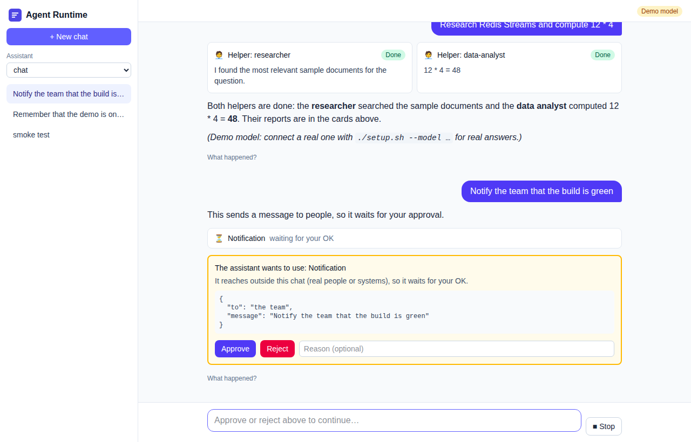

# Phase L2 — Chat UI (milestone M1: it works in the browser)

**Completed:** 2026-10-17 · **Branch:** `feat/l2-chat-ui` · **Plan:** [plans/phase-L2.md](../plans/phase-L2.md) · **Part of:** the [local release](../plans/local-release.md) · **Tests:** backend 374 · UI unit 42 · browser 14 scenarios (+1 live) · container e2e 3



## What we built

**The web UI** ([frontend/](../../frontend/)). After `./setup.sh`, http://localhost:3000 opens on the chat.
- **The stack:** React 19, TypeScript strict, Vite, Tailwind, TanStack Query, and a client generated from the API's OpenAPI spec.
- **What a person sees:**
  - a sessions sidebar;
  - replies that stream in word by word;
  - tool calls as cards (input, result, duration, "reused");
  - helpers (sub-agents) as cards with live progress, then their results;
  - an approval card with Approve / Reject and a reason;
  - Stop, which keeps the partial reply;
  - "What happened?", each reply's story in plain words, including "a worker stopped unexpectedly: another one took over".
- **Polish:** dark mode, a mobile layout, keyboard use and screen-reader announcements.

**How the chat stays correct** (the client half of exactly-once display, AC20):
- **A pure transcript reducer:** a fold over every input (replayed or live messages, tokens, turn status, helpers' progress, the refetched session).
  - It's idempotent by `seq`.
  - It keeps `lastSeq` as the highest message with no hole below it, so a reconnect always asks again for anything missing.
  - The streamed draft is replaced by the saved reply, never shown twice.
- **An EventSource adapter:**
  - a new connection resumes with `?after_seq=`;
  - the browser's own reconnects send `Last-Event-ID`;
  - on `event: reconnect` (a replica draining) or a closed stream, the adapter reconnects itself with jittered backoff.
- **A connection state machine** shows as one plain banner.
- **The safety net:** turn status events are transient, so the session is re-read on every reconnect and every 10 s during a turn.

**Untrusted output is inert:**
- Model Markdown is rendered with raw HTML skipped, a sanitised tree and safe links only.
- **Images are never loaded**, because a prompt-injected image URL would exfiltrate data when it renders.
- Tool data is always shown as text.
- A strict Content-Security-Policy sits behind all of it.

**The `ui` image** ([frontend/Dockerfile](../../frontend/Dockerfile), [nginx/](../../frontend/nginx/)).
- Unprivileged nginx (UID 101, read-only filesystem) serves the app and proxies `/api` (and `/docs`) to the API, so there's one origin and no CORS.
- SSE passes through unbuffered.
- **The API now runs as 2 replicas behind it**, with no host port of its own; nginx re-resolves them every 2 s and retries idempotent requests on the next one.

**Backend additions:**
- **`turn.status` on the session stream.** Every persisted run event carries its run's session, read in the same `UPDATE … RETURNING`, so the one post-commit publish path also tells the chat when a turn is queued, running, waiting, or ended. No publish site changed.
- **The demo responder.**
  - With the offline model, typed text used to get "(script finished)".
  - Now an ordered rule table picks a script from the user's words: calculator, note, search, two helpers, a notification needing approval, or a help text.
  - The script is stored in the run's input, so crash replays read it back. The terminal chat uses it too.
- **Small endpoints and commands:**
  - `GET /about` (version, provider, demo flag; nothing secret);
  - `runtime openapi` (the spec from default settings, the same on every machine);
  - `runtime smoke --ui` (setup also checks the page and its CSP, and archives its own test chat).

**Tooling and CI:**
- **No Node on the host:** `make ui-check`, `make ui-dev`, `make ui-api` and `make ui-e2e` run Node and Playwright in pinned containers.
- **Supply chain:** pnpm via Corepack (verified by hash), a 14-day `minimumReleaseAge`, and dependency install scripts blocked.
- **CI:**
  - a new `ui` job (lint, strict types, tests with coverage thresholds, build, and a check that the committed API types match the API);
  - the containers job now scans both images and runs the browser suite against the stack;
  - the release workflow publishes `runtime` and `ui`.

## Success criteria: results

| # | Criterion | Result |
|---|---|---|
| SC1 | Clone → chatting in the browser | ✅ A fresh clone with `./setup.sh --non-interactive --model scripted --build`: healthy in **37 s** (runtime layers cached, UI built from scratch); smoke checks the page, its CSP and a turn through `/api`. Cold time from this PR's CI run |
| SC2 | Streaming you can see | ✅ Demo model: the draft is visible before the reply completes, then replaced without a double (5/5). **Live `qwen2.5:7b` (Ollama on this Mac): streamed reply, then a calculator call (437); screen = transcript** |
| SC3 | **AC20: resume the conversation** | ✅ **5/5 each:** reload mid-reply; the API replica serving the stream `docker kill`ed; the same replica `docker stop`ped (it drains). Each time the screen ends identical to the transcript: same ids, in order, none doubled or missing. **Two fixes on the way** (below) |
| SC4 | A worker crash, seen from the browser | ✅ 5/5: `docker kill` the owning worker mid tool call; one tool card, exactly one `run.reclaimed`, the reply arrives; "What happened?" tells it |
| SC5 | Approval in the browser | ✅ 5/5 approve after a reload (the tool ran once), 5/5 reject with a reason |
| SC6 | Stop | ✅ 5/5: Send is back within 2 s; the partial reply stays, marked "(stopped before the end)"; the next message works |
| SC7 | Sub-agents live | ✅ 5/5: two helper cards with live progress, then results, then the combined answer; after a reload the results come back from the saved run |
| SC8 | Untrusted content is inert | ✅ 5/5: `<script>`, ``, `javascript:` links, an external Markdown image and HTML in a tool's error. Nothing ran, **zero requests to the external host**, no dialogs, CSP on the page |
| SC9 | Code quality | ✅ `tsc --strict`; ESLint (typescript-eslint strict, 0 warnings); 42 unit tests; **reducer 100 % lines / 97 % branches, connection machine 100 %** (thresholds enforced); API drift check in CI; backend `make check` 374 passed |
| SC10 | A sound UI image | ✅ UID 101, read-only root filesystem, **94.6 MB**; Trivy: no fixable HIGH/CRITICAL **after a fix** (libexpat, below). ⏳ Multi-arch on the first tag |
| SC11 | Accessible | ✅ axe: 0 serious or critical violations on the welcome screen and a chat (5/5); new chat, send and approve done from the keyboard |
| SC12 | Setup and docs | ✅ Re-running setup leaves `.env` byte-identical; the UI port is chosen like the others (`--port`); README, setup guides and troubleshooting updated; container e2e 15/15 through the proxy |

**The browser suite:** 70/70 (14 scenarios × 5) on the final build.

## Bugs found by testing

- **The 5× run caught a real outage window, which became two fixes.** 3 of 70 chaos runs failed.
  - nginx's passive health check had marked *every* API address down at once: the killed replica's stale address, and its restarting successor. The result was "no live upstreams" (502) although the other replica was healthy.
  - Fix: no passive down-marking, a 1 s connect timeout, every address tried in turn, and DNS re-resolved every 2 s.
  - nginx's own log now records which replica answered each request.
  - The test cleanup also had to wait for the API to be *healthy*, not just running. Otherwise it killed the only ready replica, a double failure the test never meant to stage.
- **A fixable HIGH in the nginx base** (libexpat CVE-2026-77214): the image now applies Alpine's security fixes at build, and Trivy gates the result.
- **The stream decoder crashed** on valid JSON of the wrong shape; it now checks the shape first.
- **Smaller fixes:**
  - the list didn't follow a message you sent when you had scrolled up;
  - on a phone there was no way back to the chat list;
  - a tool waiting for approval said "working…";
  - the approval card used the policy's words ("external side effect");
  - setup's smoke chat cluttered the sidebar.
- **Backend tests:** the CLI chat test depended on another test having migrated the database; it now asks for the schema itself.

## Decisions & trade-offs

- **The chat before the Studio** (the roadmap re-order): the API already served everything a chat needs, so this reached a working product about 45 h sooner.
- **One stream path:** the chat replays its transcript through the stream (`after_seq=0`) instead of loading history separately. One code path; exactly-once comes from the same reducer.
- **React 19, not R6.5's "React 18":** 19 is the current major and 18 gets no releases. **TypeScript 6, not 7:** the lint tooling doesn't support 7 yet.
- **The API behind the UI's proxy, as 2 replicas:** it makes AC20 real (another replica takes over) and gives testers one address. The API port went (`--api-port` became `--port`); `make api` for contributors is unchanged.
- **A rule-based demo model rather than a fake "smart" one:** it is labelled "Demo model" everywhere and explains how to connect a real one.
- **Retries belong to the client.** In one narrow race (a request's first try fails as a re-resolve drops the dying address), nginx open source has no next address and answers 502/504 once. The UI rides it out: the stream reconnects, queries retry, and a failed send keeps its text.

## Known issues & follow-ups

- **A send that fails in that one-second race** shows an error and keeps the text; it isn't retried automatically, because sending isn't idempotent yet. An idempotency key on `POST /messages` would allow it (candidate for L3).
- **Approving with edited arguments** (the API supports it) isn't in the UI yet.
- **Sourcemaps ship in the image** (open source; useful for bug reports).
- **Carried over from L1:** `setup.ps1` still needs a real Windows run, and the first `v*` tag (multi-arch images; then make the GHCR packages public).

## How to try it

```bash
./setup.sh                     # opens http://localhost:3000
# in the chat: "hello", "What is 12 * (3 + 4)?", "Research Redis Streams and compute 12 * 4",
#              "Notify the team that the build is green"
make ui-e2e                    # the browser suite against the running stack
make ui-e2e LIVE_MODEL=1 ARGS=tests/live.spec.ts   # with a real model behind it
make ui-dev                    # hot-reload UI on :5173 against the stack
```
