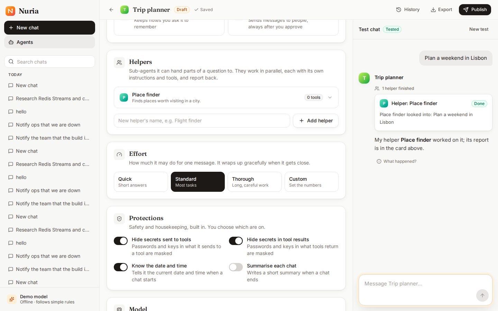

# Phase L3a — Agent Studio: agents & helpers

**Completed:** 2026-10-18 · **Branch:** `feat/l3a-agent-studio` · **Plan:** [plans/phase-L3a.md](../plans/phase-L3a.md) · **Guide:** [Build your own agent](../setup/agents.md) · **Tests:** backend 403 · UI unit 51 · browser 19 scenarios · container e2e 3



## What we built

**In Nuria, anyone can now build an agent and its helpers.** Agents → **New agent** (or **Copy** a built-in one, or **Import** a file) opens the editor:
- **Basics:** name and purpose; the id is derived and fixed.
- **Instructions:** with buttons that insert placeholders such as "today's date".
- **Tools:** plain-language cards; "Asks you first" on notifications; an optional cap per message.
- **Helpers (sub-agents):** each with its own name, purpose, instructions and tools. Only tools a helper may use are offered.
- **Effort presets:** Quick / Standard / Thorough, or Custom numbers.
- **Protections:** on/off switches for the built-in hooks.

The form autosaves. Every problem is explained next to its field, in plain words ("{{secret}} isn't something it can fill in: use the Insert buttons…").

**A test chat sits beside the form.** It runs the draft with a small budget, and approval-gated tools are **simulated**: you approve, and it shows what *would* have been sent. **Publish** asks for a valid draft *and* one complete test reply on exactly that draft. It creates an **immutable version**, and **History** lists the versions with **Restore** and **Download**. **Chat with it**, and Home's agent picker, make it available to everyone.

**The foundation: every turn pins its agent by hash** (CR-004 R15.4).
- The mechanism was designed in phase 2 but never wired up: until now a turn ran whatever definition the worker had loaded.
- Now a turn resolves its agent when it's created (a built-in file, a published version, or, in a test chat, the draft) and snapshots it as a content-addressed **bundle**: the agent and its helpers, in order.
- The run stores the hash, and workers rebuild the agent from the snapshot.
- So **publishing never changes a running or queued turn** (AC47), and neither does a deploy that edits a built-in agent.

**One validator.** The file loader and the Studio both go through `validate_definition`: if the Studio accepts an agent, a file with the same content would be accepted too, and vice versa. Import/export round-trips give the *same* content hash.

**Retry-safe sends** (left over from L2). Each message carries an `Idempotency-Key`. The UI retries a 502/503/504 or a dropped connection with the same key, and the server returns the turn it already created.

## Success criteria: results

| # | Criterion | Result |
|---|---|---|
| SC1 | **Build without code** | ✅ Browser, **5/5**: new agent → purpose → instructions (with an inserted placeholder) → 2 tools → a helper with its own instructions and tool → Quick → test chat (the helper does the work) → publish with a note → chat with it from its page; it's in Home's picker. No frontmatter on screen at any point; axe clean |
| SC2 | **One validator** | ✅ The same rules for files and documents (unit, parametrised: unknown tool, empty instructions, unknown placeholder, over a ceiling, bad id, an approval tool on a helper, duplicate helpers); issues by section and field via the API and next to the field in the browser (5/5) |
| SC3 | **AC47: immutable versions** | ✅ Integration: a v1 turn queued, v2 published, the v1 turn finishes with v1's calculator; the next turn runs v2 (no calculator). Database: changing, un-publishing or deleting a published version is refused by the trigger |
| SC4 | **Turns pin by hash (R15.4)** | ✅ A queued turn executed by workers loaded *after* a deploy that removed chat's calculator still had it; the snapshot rebuilds a definition identical to the original; the same content gives the same hash |
| SC5 | **Test chats are safe** | ✅ A notification approved in a test chat records nothing (`simulated`); its limits are tightened to the test budget; test chats aren't in the chat list |
| SC6 | **Publish needs a test** | ✅ Refused with the reasons (API 409 with `blockers`; the dialog's checklist); any edit after a test needs a new test (browser, 5/5) |
| SC7 | **Copy, history, restore** | ✅ A copy of Nuria brings its helpers; the built-in is unchanged; publish v1, v2; restore v1 gives exactly v1's document (API and browser, 5/5) |
| SC8 | **Import / export** | ✅ Export → import gives the same definition under a new id (an import never replaces an agent); zip-slip, absolute paths, oversized files, too many files, non-UTF-8, non-agent files: all rejected, nothing written |
| SC9 | **Durability unchanged** | ✅ Browser, **5/5**: a chat with a published user agent, worker `docker kill`ed mid tool call → completes on the same version, one reclaim, screen = transcript |
| SC10 | **Retry-safe sends** | ✅ The same key returns the same turn (API); the UI retries 502 / dropped connections with one key (unit); a different message while a turn runs is still a 409 |
| SC11 | Quality | ✅ Backend `make check` 403 passed; UI: lint, strict types, 51 unit tests, build (the Studio and Agents pages lazy-loaded: main bundle 481 kB); browser suite **95/95** (19 scenarios × 5), then the suites touched by the last polish 35/35 (7 × 5); container e2e **15/15** |
| SC12 | Docs | ✅ [Build your own agent](../setup/agents.md); README; design patterns; this summary |

## Bugs found by testing

- **A tool grant written as `{name: calculator}` crashed the definition parser:** a one-key mapping was taken for the shorthand `{calculator: {options}}`. Found by the document round-trip tests.
- **Migration 0010's downgrade** deleted bundle snapshots that runs still pointed at. Found only by the full suite, where real runs exist. Runs are now detached from their bundles first.
- **"Tested" lagged:** the editor re-checked every 2.5 s. Now the test chat tells the editor when a reply finishes.
- **A new test chat kept the old one on screen** until the new one was ready, so text typed in that moment was lost. The panel now clears at once.
- **Messages in validator-speak** ("unknown placeholder {{secret}} (allowed: ['agent.name', …])", "'notify' needs human approval; sub-agents can't use it"): rewritten as plain sentences, with tools by their names.
- **Smaller fixes:**
  - the dialog wasn't modal (no backdrop or focus trap): it now uses `showModal`;
  - autosave ran as an effect that watched the document: now it's a debounced command per edit;
  - the API client captured `fetch` at import time;
  - the agents test still looked for the old "coming next" notice.

## Decisions & trade-offs

- **Finish R15.4 first.** Pinning by hash touched the executor's core path. It went in first, behind every durability suite, so the Studio stands on it rather than working around it.
- **A bundle, not a main-agent hash.** Helpers are part of what a turn runs, so the pin covers the team. Helpers are stored in order (as a list, because `jsonb` doesn't keep key order).
- **"Tested" is derived, not stored:** a completed test turn whose pinned hash equals the draft's. Nothing can drift out of sync.
- **Immutability in the database** (a trigger), not only in the service: true for every client.
- **The demo model hands tasks to any agent's helpers,** so someone without a model can see their helpers work.
- **The model per agent waits for L3b:** the form says so, and agents use Nuria's model meanwhile.

## Known issues & follow-ups

- **Not yet:** a model per agent and per helper (L3b); skills, "describe your agent" and "improve my instructions" (L3c).
- **Archiving an agent** has an API but no button yet.
- **The editor has no undo** beyond History (restore a published version).
- **Carried over:** the first `v*` tag; `setup.ps1` on a real Windows machine.

## How to try it

```bash
./setup.sh                          # then Agents → New agent
make ui-e2e ARGS=tests/studio.spec.ts
```
