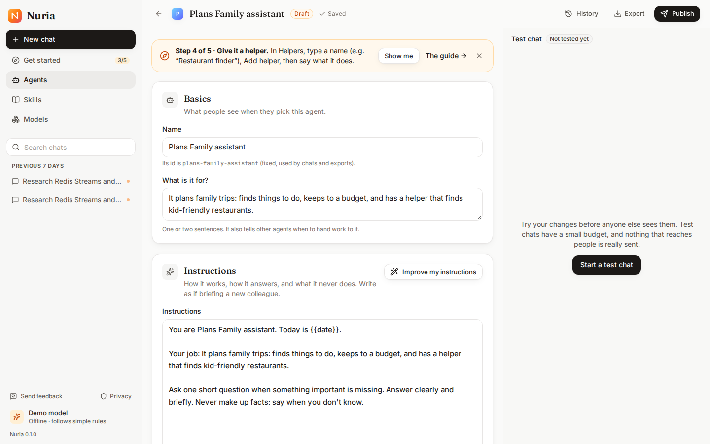

# Phase L3d — Getting started: a guided first agent

**Completed:** 2026-10-19 · **Branch:** `feat/l3d-guide` · **Plan:** [plans/phase-L3d.md](../plans/phase-L3d.md) · **Guide:** [Getting started](../setup/getting-started.md) · **Tests:** backend 558 · UI unit 62 · browser 4 new scenarios

## What we built

**Get started**, the newcomer's path to a first agent in five real steps:
1. Choose a model.
2. Create the agent.
3. Give it a tool.
4. Give it a helper.
5. Try it, publish it and chat with it.

How it works:
- **Entry points:** Home offers it, the sidebar shows the progress ("2/5"), and nothing starts by itself.
- **Self-ticking steps:** each step ticks as soon as it's true, wherever it was done.
- **Step 1, choosing a model:**
  - finds Ollama on the computer, or shows how to install it on your system and which model to pull, with **Check again**;
  - takes a key (OpenAI, Azure AI Foundry, any OpenAI-compatible service);
  - or skips to the demo.

  A model added there is tested and made the default.
- **Step 2, creating the agent:** Describe it (an example is filled in), a template, or one of yours.
- **Steps 3 to 5 happen in the Studio:** a strip says what to do there. **Show me** scrolls to the section and moves focus to it, and the strip ticks without a reload.

**Progress is derived, not stored.** `onboarding.py` reads facts already in the account:
- a ready default model, or a real model chosen in setup;
- the guide's agent, with a tool and a helper;
- a completed test-chat turn, a published version, a real chat.

So progress is the same in every browser, and it un-ticks when something is undone. Only the guide's choices are stored (migration 0014): its agent, "demo for now", hidden.

**Ollama is setup's default** (you asked for it during this phase):
- **What it offers:**
  - setup lists Ollama first and uses it when nobody answers;
  - without the Ollama app on macOS or Windows, it offers to install the app before falling back to Docker;
  - it downloads the recommended model into a running Ollama, asking first;
  - it picks `qwen2.5:3b` when Docker has under 12 GB of memory.
- **What stays:** keys remain an option, in setup and in the app. The demo is the last choice.

## Success criteria: results

| # | Criterion | Result |
|---|---|---|
| SC1 | **A first agent, guided** | ✅ Browser, by visible labels, **5/5**: Home → Get started → a model by key → Describe it → (tool and helper drafted) → test → publish → chat → "You built…"; every step ticked without a reload |
| SC2 | **Ollama, both ways** | ✅ Found: offered with its models (browser, this machine). Not found: install steps for the person's OS and Check again (browser in CI, where there's no Ollama). ⚠️ **Live, the model didn't load** on this Mac: its Ollama runs in Docker (7.7 GB of memory for everything), and `qwen2.5:7b` timed out loading. That's why setup now prefers the app and picks the 3B model on a small Docker |
| SC3 | **The demo path** | ✅ Browser, **5/5**: demo for now → Describe it → the strip walks through adding a helper (ticks without a reload), the test, publishing |
| SC4 | **Progress can't lie** | ✅ Integration: removing the helper un-ticks step 4; archiving the agent asks for one again; the same progress from any client |
| SC5 | **Never in the way** | ✅ Browser: nothing starts by itself; Not now hides the card and the sidebar entry; `#/start` still works; Start over |
| SC6 | **Accessible** | ✅ Inline regions, no overlay or focus trap; keyboard-only run; axe clean on the guide, the Studio with the strip and Home |
| SC7 | **Short** | ✅ 5 steps; the whole path ran in about 15 s in the browser test (well under 10 minutes) |
| SC8 | Quality | ✅ Backend `make check` 558 passed; UI check (62 unit tests); browser suite **5×: 175 passed, 0 failed** (15 skipped: live model and observability-only) |

## Bugs found by testing

- **The guide page didn't notice a chat that had just ended.** It now looks again every few seconds while unfinished, so steps done in another tab tick too.
- **The model dialog's "open on a kind" ran as an effect** (a lint error, and a double render): the dialog now starts from what the guide already found.
- **Describe it took focus on a page**, not only in a dialog.
- **Demo drafts were named "Plans Family assistant"**: now "Family Trips assistant".
- **A test stack in use looked like the product:** drafts by the test-only fake model ("Fake scout") showed up while browser tests ran. Not a product bug, but a reason to keep test stacks separate from the one people try.

## Decisions & trade-offs

- **No tour library:** spotlight tours are the hardest pattern to make accessible, and the permissive ones are all spotlights. Inline strips and a checklist use the components the app already has.
- **"Try" means tested, published and chatted:** one step, three visible ticks, so the last step is about using the agent.
- **The version stays 0.1.0 in this PR:** tagging v0.1.0 and then v0.1.1 is a release decision.

## Known issues & follow-ups

- **Not yet checked live:** Ollama's model load on a machine with the Ollama app, or on Docker with more memory.
- **Next, as asked:** **real tools** (web search, reading pages, running code and shell commands in a sandbox) instead of the demo calculator, notes and fixture search. Plan to follow.
- **Carried over:**
  - tag v0.1.0 (and make the GHCR packages public);
  - the AC43 tester sessions (M2);
  - `setup.ps1` on a real Windows machine.
