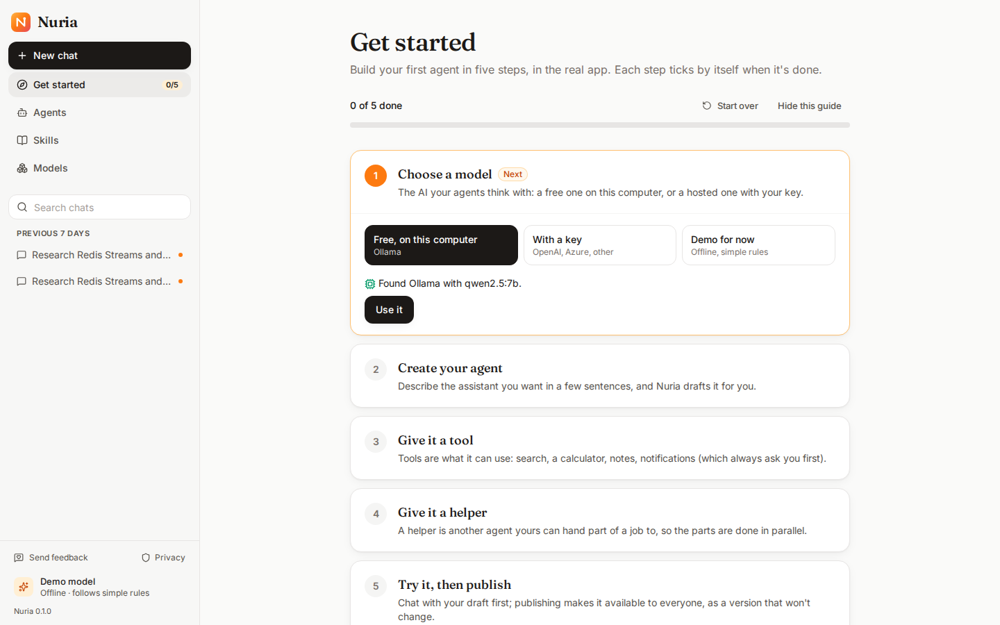

# Getting started: your first agent, step by step

The first time you open Nuria, Home offers **Get started** (it's also in the sidebar, with your progress). It walks you through building your first agent in five steps, in the real app. Each step ticks by itself once it's done, from any screen.

| Step | What you do | Where |
|---|---|---|
| **1. Choose a model** | **Free, on this computer:** Nuria looks for Ollama. If it's there, **Use it**; if not, it shows how to install it on your system and which model to pull (`ollama pull qwen2.5:7b`), then **Check again**. **With a key:** OpenAI, an Azure AI Foundry deployment, or any OpenAI-compatible service; the key is encrypted on your computer. **Demo for now:** offline and simple, to see how things fit; add a real model later. A model you add is tested (it must answer and use tools) and becomes the default. | In the guide |
| **2. Create your agent** | **Describe it** in a few sentences (an example is filled in for you) and Nuria drafts it; or start **from a template**; or pick one of yours. | In the guide |
| **3. Give it a tool** | Switch on a tool it needs: search, calculator, notes, notifications (which always ask you first). | The Studio |
| **4. Give it a helper** | A helper is another agent yours can hand part of a job to. Type its name, **Add helper**, say what it does. | The Studio |
| **5. Try it, then publish** | Send a message in the **test chat**, then **Publish**, then **Chat with it**. | The Studio, then a chat |

In the Studio, a strip at the top says which step you're on and what to do there; **Show me** takes you to the right section. If a real model drafts your agent, steps 3 and 4 may already be done.

**Good to know**
- Nothing starts by itself. **Not now** (on Home) or **Hide this guide** puts it away; it's still at `#/start`. **Start over** begins again (your agents and models stay).
- Progress is worked out from what exists, so it's the same in every browser, and undoing something (removing the helper) un-ticks its step.
- Next: [skills](skills.md) (know-how your agent loads when it needs it), [models](models.md), and the full [Studio guide](agents.md).
